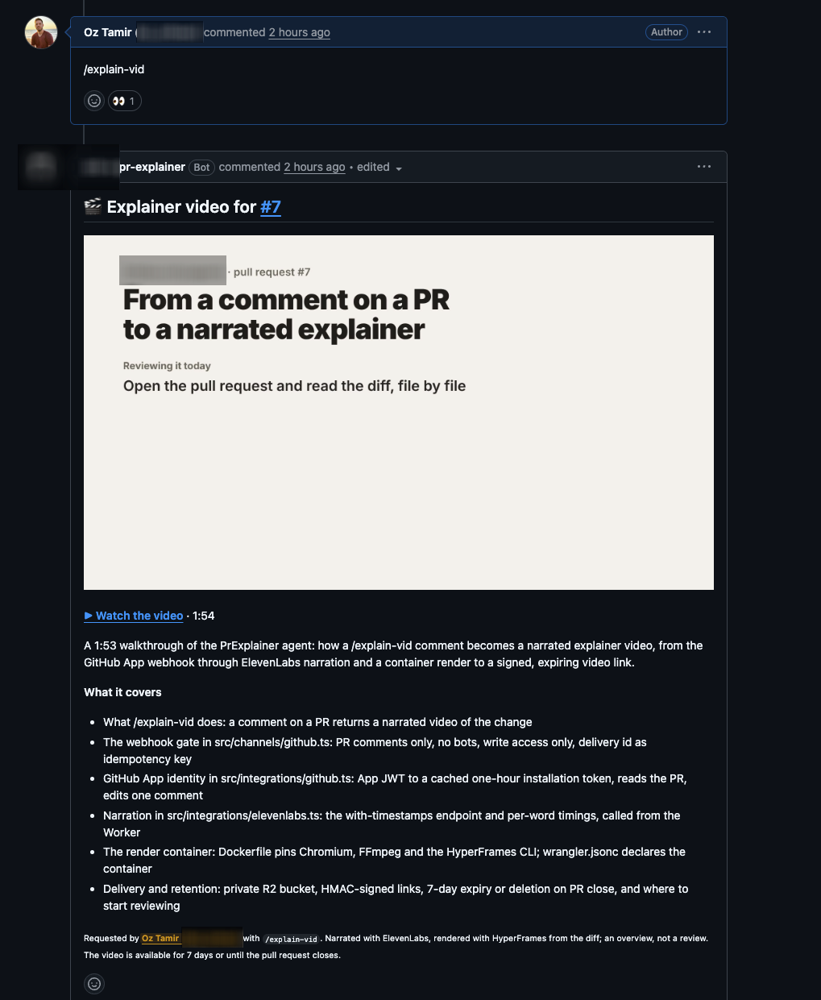

As anyone working in tech will tell you, one of the side effects of the agent-assisted coding revolution is that the bottleneck, which used to be writing code, is now code reviews. Reading thousands of lines of code is hard, and it takes more time than writing them, which can now be a matter of minutes.

For example: a few days ago I got a pull request from a teammate. A few thousand lines across a few dozen files, written in an afternoon with a coding agent. And I was the reviewer.

I did what any responsible reviewer does. I opened the "Files changed" tab, started scrolling, and about ten minutes in I realized I had no idea what I was looking at. Not because the code was bad, mind you. There was just so much of it, and no story holding it together.

So I did the next responsible thing and Slacked him: "hey, got 10 minutes for a walkthrough?"

That walkthrough never happened. He was busy, I was busy, and the PR just sat there, waiting for one human to explain it to another human.

And while I was waiting, I thought to myself: an agent wrote this thing in an afternoon. Why am I waiting on a person to explain it to me?

## Can this be automated?

What I actually wanted wasn't a better diff viewer. I wanted the walkthrough: someone talking me through what this change is for, how it works, and where I should start reading.

I wanted a video. So I decided to use [HyperFrames](https://hyperframes.dev). If you haven't come across it, HyperFrames is a framework for making videos out of HTML: every scene is a web page, the animations are a [GSAP](https://gsap.com) timeline, and the renderer opens the page in a headless browser, seeks through the timeline frame by frame, and stitches the frames into an mp4. The nice part is that it comes with a Claude Code skill, and Claude happens to be very good at writing HTML. So instead of me learning a video editor, Claude writes the video.

But a silent video with text flying around wasn't going to cut it. I wanted it to feel like a real person walking me through the PR, which is what I had asked my teammate for in the first place. So I also opted to add voice narration using [ElevenLabs](https://elevenlabs.io). They have an MCP server, which means Claude can pick a voice, hand it a script, and get an mp3 back without ever leaving the session.

Video from HyperFrames, voice from ElevenLabs, and Claude Code to glue it all together. I opened it in the repo and gave it this:

> Create an explainer video for this PR: `<link to the PR>`; It should use natural voice narration using the ElevenLabs MCP and use Hyperframes for the video itself. The video should explain the goal of the PR, how this outcome is achieved, and what are the changes. End the video with a suggested, prioritized list of files for the PR reviewer to go through. The entire thing should be 1min long at most.

That's the whole prompt.

## It just worked

I'd love to tell you about the three rounds of debugging that followed. There weren't any.

Claude read the PR with `gh`, loaded the HyperFrames skill, and before touching any HTML it wrote a script: about 120 words, five scenes. What the change is for, how it works, what the diff adds and removes, and which files to read first. Then it asked ElevenLabs for the list of available voices, picked one that sounded like it belonged in an explainer, and generated the narration through the MCP.

Then came the part I didn't expect. Once it had the mp3, it ran it through whisper to get a timestamp for every spoken word, and used those timestamps as the clock for the entire video. Every scene starts on the word that introduces it. Every file name pops on screen the moment the voice says it. Left to my own devices I would have slapped the audio under a slideshow and called it a day. Claude cut the video to the voice.

From there it was the boring kind of work: one HTML file per scene, a few sound effects on the visible actions (a key tick when the command gets typed, a pop when something lands), `hyperframes check` until it stopped complaining, render. About sixteen minutes after I hit enter on the prompt, there was a 47-second mp4 in my Downloads folder.

The original video explains an internal PR, so I can't show it here. But the prompt is the prompt, so here's the exact same thing run on a pull request in my [MCPlexer](https://github.com/OzTamir/mcplexer) repo:

![[mcplexer-pr7-explainer.mp4|poster=mcplexer-pr7-explainer-poster.png|title=The same prompt, run on an MCPlexer pull request]]

I posted the video in one of our internal Slack channels, mostly to show off. Pretty quickly, a few people reached out to say they'd love for this to become part of our workflow.

Which is how "can this be automated?" turned into "this should be a bot".

## Oh yeah, it's agent time

My first instinct was the lazy one: wrap the whole flow in a `SKILL.md`, commit it to the repo, and let everyone run it from their own Claude Code. Then I thought about what that actually means. Every person who wants a video has to set up the ElevenLabs MCP, install the HyperFrames skill, and babysit a sixteen-minute render on their own machine. For a one-off, fine. As a workflow? Nope.

If this was going to be part of how we review PRs, it had to live where PRs live: on GitHub. You type `/explain-vid` on a pull request, and a minute or two later there's a video under it.

For that, I needed somewhere for an agent to live, and that somewhere turned out to be [Flue](https://flueframework.com). Flue is an open agent framework in TypeScript: you write an agent as a function, give it a model, some tools and a block of instructions, and deploy it as a Cloudflare Worker.

So I described the manual flow to Claude, step by step, and asked it to turn it into an agent. Claude wrote nearly all of [the code](https://github.com/OzTamir/explainer-video-agent). I directed, reviewed, and fixed. It's the same loop as the video itself, one level up.

## So what does the solution look like?

The whole thing is one Flue agent deployed as a single Cloudflare Worker, plus three things around it:

- A **GitHub App**, installed on the repos that should answer to `/explain-vid`. Its webhook triggers the agent, and the agent posts its comments as the App.
- A **Cloudflare Sandbox container**, built from a Dockerfile with Node, Chromium, FFmpeg, the HyperFrames CLI and its skills baked in. This is where the agent writes and renders the video. One container per pull request, and it goes to sleep after ten minutes of idle time.
- A private **R2 bucket** for the output.

ElevenLabs and GitHub are called from the Worker, never from inside the container, so neither API key ever enters the shell the model is working in.

Here's what happens when you comment:

1. The GitHub App's webhook hits the Worker. The channel checks that the comment is on a pull request, that it's `/explain-vid` (alone, or with a note like `/explain-vid focus on the migration`), and that the author has write access to the repo. Anything else gets ignored.
2. The agent reacts with 👀, posts a progress comment, and starts reading. It gets the PR's facts and file list through one tool, and the actual diff hunks for the files that matter through another (lockfiles, generated code and vendored stuff are flagged as noise).
3. It writes a script and a director's brief into a fresh HyperFrames project in the container.
4. It sends the script to ElevenLabs. This is where the manual flow got an upgrade: ElevenLabs has a text-to-speech endpoint that returns the audio *with* timestamps, so the agent gets the start and end time of every spoken word straight from the API. No whisper pass needed.
5. It builds one HTML scene per paragraph, cut to the word timings, and runs `hyperframes check` until it's clean.
6. It renders, uploads the mp4 and a poster frame to the bucket, and replaces the progress comment with the final one: poster, play link, duration, a one-line summary and a few bullets.

*One comment in, one comment out.*

## Reviewing is the new bottleneck

We've spent the last couple of years pointing AI at the writing side of software. I think the reading side deserves the same attention. If an agent can produce a few thousand lines in an afternoon, it can also produce the walkthrough that goes with them: what this is for, how it works, where to start. It's the same model looking at the same diff, just answering a different question.

`/explain-vid` is one small answer to that. It doesn't review the code for you, and it shouldn't. It gives you the ten minutes my teammate never had, on demand, under every PR that needs them.

The code is [on GitHub](https://github.com/OzTamir/explainer-video-agent), MIT licensed, with setup docs. Bring your own Cloudflare account, GitHub App and ElevenLabs key, deploy the Worker, and go comment on something big.
